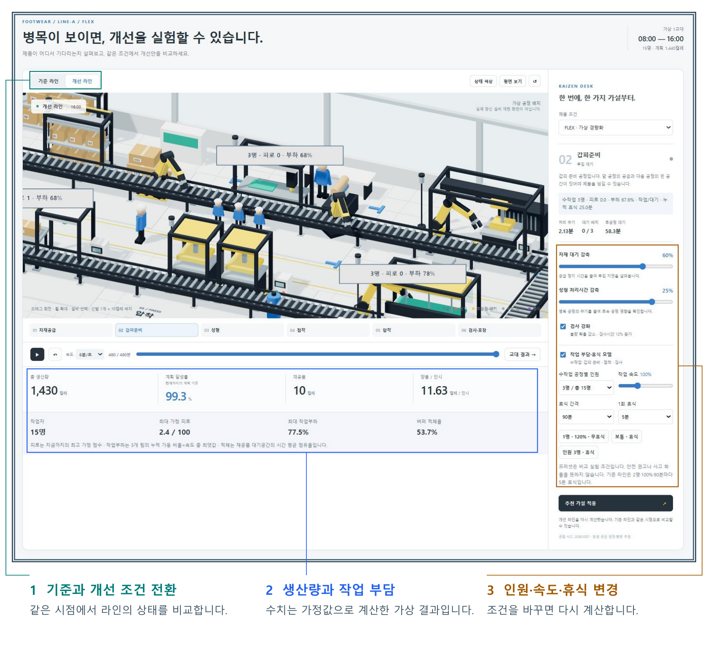
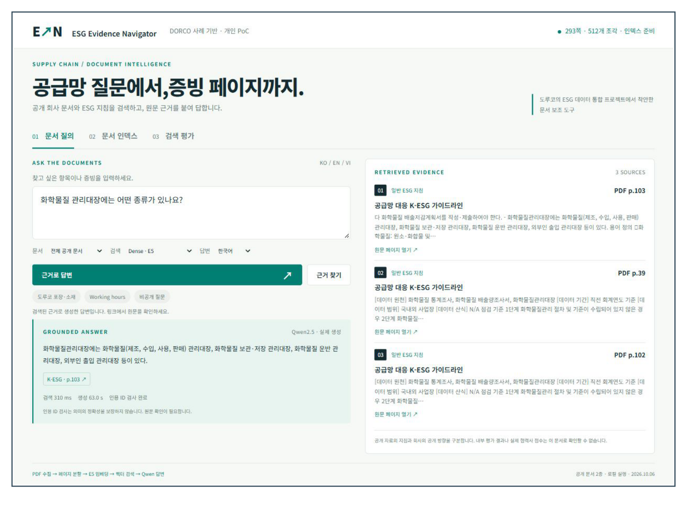
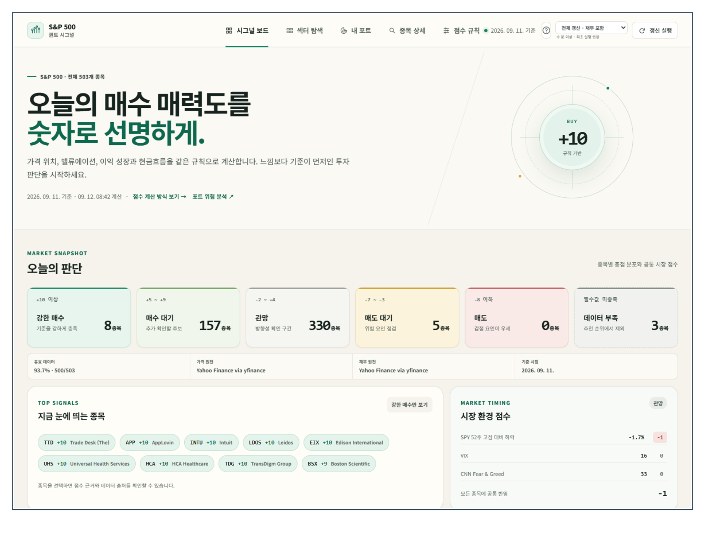

# 김현태 Kim Hyeon Tae

### AI와 Linux로 도구를 만들고, 결과를 확인합니다.

부산대학교 정보컴퓨터공학부 졸업 · LS웨어 QA 인턴 경험 
**LG전자 AX Workflow 수강 중** · 2026.11.12 종료 예정

AI·Linux·QA를 활용해 도구를 만들고 결과를 확인합니다. 생산라인의 조건을 바꾸는 가상 실험, 공개 문서의 원문을 찾는 RAG, 금융데이터의 출처와 누락을 확인하는 프로젝트를 진행했습니다. 목표 직무인 AI 업무 지원·소프트웨어 검증·데이터 확인 업무에 활용할 수 있는 도구를 구현한 경험입니다.

[대표 프로젝트](#대표-프로젝트) · [경력·학력](#경력과-학력) · [교육·활동](#교육과-활동) · [어학·SW 역량평가](#어학과-sw-역량평가)

[LinkedIn](https://www.linkedin.com/in/%ED%98%84%ED%83%9C-%EA%B9%80-921673433/) · [YouTube](https://www.youtube.com/@americastock-e8s) · [전체 저장소](https://github.com/Kimhyuntae9665?tab=repositories)

 

## 대표 프로젝트

### 신발 생산라인의 인원과 작업 조건을 바꿔 봅니다.

**[Line Lens](https://github.com/Kimhyuntae9665/line-lens)** · 가상 신발 생산라인 시뮬레이터

신발 생산라인에서 인원·작업 속도·휴식·자재 대기 조건을 바꾸고 생산량과 작업 부담을 비교하는 가상 시뮬레이터입니다. 자연어로 목표를 입력하면 로컬 AI가 조건을 정리하고 시뮬레이터가 계산한 후보를 사람이 비교·적용합니다. 생산 데이터 분석과 개선 조건 비교 업무에 활용할 수 있는 도구를 구현한 경험입니다.

**화면 읽기:** 왼쪽 위에서 기준·개선 조건을 전환하고, 오른쪽에서 인원·속도·휴식을 바꾼 뒤 아래 결과를 비교합니다. 이미지 속 숫자는 합성·가정값으로 계산한 가상 결과입니다. [원본 화면 확대](https://github.com/Kimhyuntae9665/line-lens/blob/main/docs/screenshots/09-worker-factory.jpg)

LG전자 AX Workflow 교육 중 평택 공장을 견학하며 디지털 트윈 기반 공장 시뮬레이션을 보고 직접 조건을 바꿔 시험하는 도구를 만들어 보고 싶었습니다. 실제 공장 연결과 실측 보정이 없는 가상 실험용 프로토타입입니다. 저는 방향·기능을 제안하고 화면·설명을 검토했으며 Codex를 활용해 구현과 계산 검증을 진행했습니다.

 

### 문서에 질문하면 답변과 원문 페이지를 함께 보여줍니다.

**[ESG Evidence Navigator](https://github.com/Kimhyuntae9665/dorco-esg-rag)** · 공개 문서 검색·답변 도구

공개 PDF에서 질문과 관련된 내용을 찾고 로컬 Qwen 답변에 원문 페이지를 연결하는 개인 PoC입니다. 문서 검색·근거 확인 업무에 활용할 수 있는 RAG 도구를 구현한 경험입니다. 공개 문서 기반의 개인 프로젝트이며 회사 내부 시스템이나 협력사 데이터에 연결한 결과는 아닙니다. 과제 선정과 요구사항을 정리하고 Codex의 조사·코드 작성·검토 지원을 활용했습니다. 인용 ID 확인만으로 답변의 의미 정확성을 보장하지 않아 원문 대조가 필요합니다.

왼쪽의 질문·답변과 오른쪽의 원문 페이지를 함께 확인합니다. 화면은 **2026.10.06 실행 사례**입니다. [원본 화면 확대](https://github.com/Kimhyuntae9665/dorco-esg-rag/blob/main/docs/screenshots/04-ledger-answer.jpg)

 

### 주식 점수의 출처와 빠진 데이터를 확인합니다.

**[S&P 500 Quant Signal](https://github.com/Kimhyuntae9665/sp500-quant-signal)** · 금융데이터 확인·리서치 도구

같은 규칙으로 종목을 비교하고 점수의 출처·기준일·빠진 데이터·오래된 캐시 상태를 확인하는 리서치 도구입니다. 데이터 품질 확인과 리서치 업무 지원에 활용할 수 있는 도구를 구현한 경험입니다. 캡처는 2026.09.12 기준이며 화면의 가격과 점수는 현재 값이나 투자 성과를 뜻하지 않습니다. Codex를 활용한 개발·검증 작업입니다.

점수만 보지 않고 **데이터 부족·출처·기준일**을 함께 읽습니다. [원본 화면 확대](https://github.com/Kimhyuntae9665/sp500-quant-signal/blob/main/docs/screenshots/01-dashboard-desktop.png)

## 경력과 학력

### LS웨어 품질관리팀 · QA 인턴

**2024.09.02 ~ 2024.12.31**

서버보안 소프트웨어를 확인할 Linux TestBed를 구성했습니다. 설치·기동·접속·기능을 단계별로 점검하고 실패 조건을 나눠 재현했습니다. 설치·점검·트러블슈팅 순서는 다음 담당자가 따라갈 수 있는 가이드로 정리했습니다. 소프트웨어 검증 업무에 필요한 환경 구성·실패 재현·문서화를 수행한 경험입니다.

| 학교 | 전공·기간 |
| :--- | :--- |
| **부산대학교** | 정보컴퓨터공학부 · 2020.03 ~ 2026.08 졸업 |
| 울산우신고등학교 | 2016.03 ~ 2019.02 |

## 교육과 활동

### LG전자 K-뉴딜 아카데미 · AX Workflow

**수강 중** · 2026.08.24 ~ 2026.11.12 종료 예정 · **전체 예정 411시간** 
수강 상태 기준: 2026.10.11

RAG·CAG·온톨로지와 문서 검색·응답 맥락 구성을 학습하고 있습니다. 오픈소스 Qwen을 실행할 컴퓨팅 자원을 확보하기 위해 여러 노트북을 활용한 클러스터 구성 실습도 진행 중입니다. 전체 예정 411시간이며 2026.11.12 종료 예정입니다.

### 부산대학교 비교과 교육

- **2025 PNU Mini Bootcamp · AWS AI Cloud 활용과정** — 2025.02.11 ~ 02.12 Amazon Bedrock, Titan·Llama, 이미지 생성, Streamlit·LangChain, Lambda·서버리스 기초 학습·실습.
- **오픈소스소프트웨어 특강** — 2024.03.22 ~ 04.12 · 4회, 총 12시간 GitHub·Linux kernel·오픈소스 커뮤니티 활용, 여러 오픈소스 도구와 Linux 서비스 탐색·실습.

### ASTRO 동아리 · 소프트웨어 팀장

활동 **2024.06 ~ 2026.08** · 팀장 **2025.06 ~ 2026.08**

무인드론 프로젝트와 대회 준비에서 Jetson Nano·Xavier 환경 설정, YOLOv5n 구성·TensorRT 최적화와 VPN 네트워크 구성을 맡았습니다. KASA 관련 ASTRO_LANDER에서는 Linux·Gazebo 환경 설정, YOLOv8n 구성·TensorRT 최적화를 담당했습니다. 임베디드 AI 환경 구성과 반복 시험 업무에 연결되는 팀 프로젝트 경험입니다.

### 수상과 대회

- **2026년 KASA 우주항공 학술 경연대회 장려상** — 2026.09.12 · **ASTRO LAUNCHER 팀 명의** 본인 확인 기록에 따른 팀 수상입니다.
- **제24회 한국로봇항공기경연대회 / AAM Tech Challenge** — 1차 예선 참가 Jetson Nano·Xavier, YOLOv5n·TensorRT 관련 본인 담당은 위 ASTRO 활동에 기재했습니다.

### 공개 작업과 콘텐츠

- **GitHub 공개 프로젝트** — 현재 확인 가능한 공개 이력 기준 2021.05부터. 프로젝트 문서·코드·검증 기록을 공개합니다.
- **AI Agent를 활용한 미국주식 Shorts 제작·게시** — 2026.08부터. [YouTube 채널](https://www.youtube.com/@americastock-e8s)에서 볼 수 있습니다.
- **함께 볼 저장소:** [Codex total](https://github.com/Kimhyuntae9665/codex-skill-total) · [6.1 Sol Orch](https://github.com/Kimhyuntae9665/codex-skill-6-1-sol-orch) · [PilotDeck](https://github.com/Kimhyuntae9665/PilotDeck)

## 어학과 SW 역량평가

| 평가 | 결과 | 응시·평가일 |
| :--- | :--- | :--- |
| **TOEIC** | **850** | 2026.03.15 |
| **OPIc** | **IM2** | 2026.06.14 |
| **TOPCIT** · SW 역량평가 | **512 / 1000 · 수준 3** | 2025.05.24 |

## 사용·학습한 도구

| 분야 | 도구와 사용 범위 |
| :--- | :--- |
| 환경 구성·검증 | Python · Linux · Git/GitHub · PowerShell · Shell |
| AI·문서 검색 | Qwen · RAG · CAG · 온톨로지 학습·실습 |
| 임베디드·시뮬레이션 | Jetson Nano/Xavier · YOLOv5n/YOLOv8n · TensorRT · Gazebo |

내용 기준: 2026.10.11. 경력·활동·교육의 본인 확인 내용과 공개 프로젝트 기록을 사용했습니다. 프로젝트마다 가상 실험·개인 PoC·팀 경험·Codex 지원 범위를 구분했습니다. 점수 증명서와 개인정보 원본은 게시하지 않습니다.
